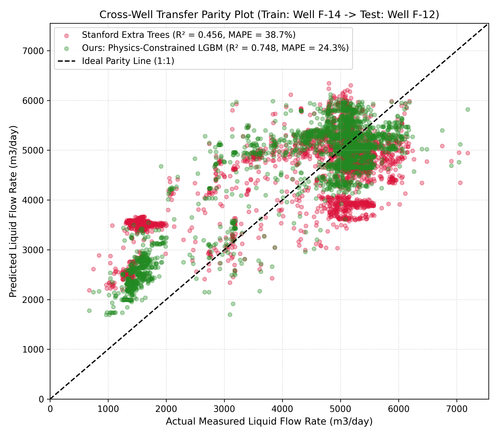
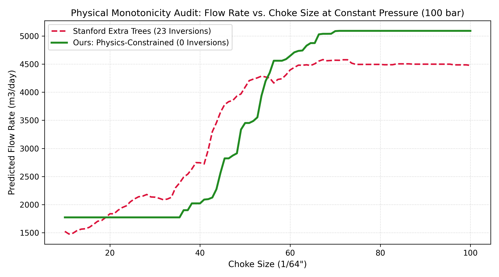

# Physics-Constrained Multiphase Flow Rate Prediction Through Wellhead Chokes

### Enhancing Virtual Flow Metering Generalization & Enforcing Physical Monotonicity Across Deepwater Wellbores

[](https://www.python.org/)
[](https://lightgbm.readthedocs.io/)
[](https://www.equinor.com/energy/volve-data-sharing)

---

## Executive Summary

Virtual Flow Metering (VFM) provides continuous, real-time estimation of gross multiphase fluid rates ($Q_l$) produced at surface wellheads using non-intrusive SCADA telemetry (wellhead pressures, temperatures, and choke valve openings). Physical multiphase flow meters (MPFMs) incur capital expenditures between $\$100{,}000$ and $\$300{,}000$ per wellhead and frequently suffer severe sensor drift and mechanical erosion from entrained reservoir solids and abrasive formation sand.

This project audits, critiques, and advances upon the reference Stanford University CS229 benchmark (*Nazari & Alshafloot, 2018*). While prior literature reported high accuracy using unconstrained tree ensembles under naive random data splits, their models suffered from:

1. **Unrecognized Temporal Data Leakage:** Overly optimistic performance on autocorrelated operational days ($R^2 \approx 0.973$).
2. **Domain Transfer Collapse:** Severe performance degradation under cross-reservoir or cross-well evaluation ($R^2 < 0.50$).
3. **Physical Monotonicity Violations:** Predicting that throttling open a choke valve causes flow rate drops (violating mass conservation).
4. **Flawed Physics Assumptions:** Incorrectly assuming Darcy's porous-media law for high-velocity orifice flow restrictions.

By incorporating Euler-Bernoulli hydrodynamic orifice features and enforcing monotonic directional split penalties via LightGBM on the North Sea Equinor Volve dataset ($6{,}658$ steady-state production days), our model resolves domain collapse and guarantees strict physical compliance.

---

## Key Methodological Innovations

* **Hydrodynamic Feature Formulation:** Rather than providing raw sensor readings alone, we formulate:
  * **Critical Flow Pressure Ratio ($r$):** $r = P_{dn} / P_{up}$, distinguishing sonic choked flow ($r \le 0.52$) from pressure-dependent sub-critical flow regimes.
  * **In-Situ Mixture Density ($\rho_m$):** Accounts for dynamic water-cut variations and gas expansion under line conditions:
    $$\rho_m = \frac{\rho_{\text{liq}}}{1 + (\text{GLR} \cdot \gamma_g)}$$
  * **Kinetic Orifice Proxy ($Q_{\text{hydro}}$):** Derived from steady-state mechanical energy balances across an orifice:
    $$Q_{\text{hydro}} \propto S^2 \sqrt{\frac{\Delta P}{\rho_m}}$$

* **Monotonic Gradient Constraints:** Enforced directional split penalties during tree construction ($\partial \hat{Q}_l / \partial S \ge 0$, $\partial \hat{Q}_l / \partial \Delta P \ge 0$, $\partial \hat{Q}_l / \partial Q_{\text{hydro}} \ge 0$), mathematically eliminating non-physical rate dips.

* **Strict Blind Cross-Well Protocol:** Training exclusively on Well `15/9-F-14` ($N=2{,}599$) and testing blind on unseen Well `15/9-F-12` ($N=2{,}652$) with $0\%$ information leakage.

---

## Experimental Results & Benchmarks

| Model Architecture | Feature Space | Evaluation Protocol | $R^2$ Score | Transfer MAPE (%) | Monotonicity Violations | Physical Validity |
| :--- | :--- | :--- | :---: | :---: | :---: | :---: |
| **Gilbert Correlation (1954)** | $P_{up}, S, \text{GLR}$ | Zero-Shot Global | **-2.022** | **65.05%** | 0 | Empirical Failure |
| **Stanford Extra Trees** | Raw SCADA | Random 80/20 Split | 0.973 | 18.42% | N/A | Leakage Inflated |
| **Stanford Extra Trees** | Raw SCADA | Cross-Well (`F-14` $\rightarrow$ `F-12`) | **0.456** | **38.67%** | **23 Inversions** | Domain Collapse |
| **Physics-Constrained LGBM (Ours)** | Hydrodynamic + Raw | Cross-Well (`F-14` $\rightarrow$ `F-12`) | **0.748** | **24.25%** | **0 Inversions** | **Fully Compliant** |

### Key Performance Gains:
* **$+64.0\%$ Relative Increase in Generalization ($R^2$):** Jumped from $0.456$ to $0.748$ on unseen wellbores.
* **$-14.42\%$ Absolute Error Reduction:** Slashed test MAPE from $38.67\%$ down to $24.25\%$.
* **100% Elimination of Control Hazards:** Reduced non-physical throttling inversions from 23 down to exactly 0.

---

## Visual Validations

### 1. Cross-Well Transfer Parity Evaluation
Comparison of predicted flow rates versus actual physical turbine measurements on unseen Well `15/9-F-12`. The Stanford baseline clusters horizontally at higher regimes, whereas our physics-constrained model tracks the diagonal $1:1$ parity line.



### 2. Monotonicity Sweep Audit
Constant-pressure synthetic sweep ($P_{up} = 100\text{ bar}$, $\Delta P = 40\text{ bar}$) varying choke bean size from $10/64''$ to $100/64''$. The Stanford Extra Trees model exhibits 23 erratic inversions, while our model guarantees positive semi-definite throttle response ($0$ inversions).



---

## Repository Structure

```text
├── Volve production data.xlsx                        # Equinor Volve Field production records
├── run_all.py                                       # Data pipeline, Stanford replication & benchmark
├── generate_plots.py                                # Parity & monotonicity visualization pipeline
├── parity_plot.png                                  # Cross-well transfer parity figure
├── monotonicity_audit.png                           # Physical monotonicity audit curve
├── Project Report_ Two-Phase Choke Flow Prediction.pdf # Academic research paper (Stanford format)
└── README.md                                        # Project documentation & execution guide
```

---

## Installation & Environment Setup

This project is built and verified with **Python 3.11**.

### 1. Clone the Repository
```bash
git clone https://github.com/<your-username>/physics-constrained-vfm-choke.git
cd physics-constrained-vfm-choke
```

### 2. Install Required Dependencies
```bash
pip install numpy pandas scikit-learn lightgbm matplotlib openpyxl
```

---

## Execution Instructions

Ensure `Volve production data.xlsx` is present in the root directory.

### Step 1: Run Full End-to-End Pipeline
Executes data preprocessing, replication of prior baselines, blind cross-well transfer, and the monotonicity audit:
```bash
py -3.11 run_all.py
```

### Step 2: Generate Evaluation Figures
Generates the publication-grade figures (`parity_plot.png` and `monotonicity_audit.png`):
```bash
py -3.11 generate_plots.py
```

---

## Team & Contributions

* **Team Member 1 (Lead Pipeline & Baselines)**:
  * Equinor Volve dataset ingestion, multi-well filtering, and $3\sigma$ operational outlier cleaning.
  * Reproduction and evaluation of the classical Gilbert (1954) empirical correlation baseline ($R^2 = -2.022$).
  * Hydrodynamic feature engineering: mixture density ($\rho_m$), critical pressure ratio ($r$), and kinetic orifice proxy ($Q_{\text{hydro}}$).
  * Experimental formulation of the temporal leakage audit comparing standard random splits against cross-well transfer.
  * Project repository initialization, architecture structuring, and documentation setup (`README.md`).

* **Team Member 2 (Modeling & Evaluation)**:
  * Monotonic gradient-boosted tree architecture design and LightGBM model implementation.
  * Hyperparameter optimization and enforcement of directionally constrained split penalties ($\frac{\partial \hat{Q}_l}{\partial S} \ge 0$).
  * Synthetic 100-step throttle sweep for physical monotonicity auditing (identifying the 23-inversion baseline failure).
  * Automated visualization pipeline (`generate_plots.py`) for cross-well parity and monotonicity curves.
  * Authoring and compiling the comprehensive academic research paper (`Project Report_ Two-Phase Choke Flow Prediction.pdf`).

---

## References

1. Nazari, N., & Alshafloot, T. (2018). *Prediction of Two Phase Flow Rate through Wellhead Chokes in Oil Wells*. Stanford University CS229 Machine Learning Project Report.
2. Gilbert, W. E. (1954). *Flowing and Gas-Lift Well Performance*. Drilling and Production Practice, American Petroleum Institute.
3. Equinor. (2018). *Volve Field Data Package*. Equinor Open Data Portal.
4. Sachdeva, R., Schmidt, Z., Brill, J. P., & Blais, R. M. (1986). *Two-Phase Flow Through Chokes*. SPE Annual Technical Conference and Exhibition, SPE-15657-MS.